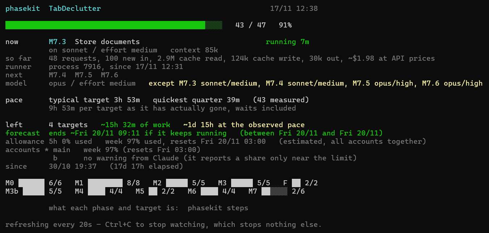

# phasekit

[](https://github.com/RobertoReale/phasekit/actions/workflows/tests.yml)

Run a long refactor as a series of unattended agent sessions that you can actually review.

One plan, split into phases. One phase per headless run, on its own git branch, one commit
per task, gates green before every commit. The runner survives usage limits, pins the
conversation so your answers reach the right session, prints what the agent is doing
while it does it, forecasts when the sequence ends, and hands every new agent the lessons
the earlier ones verified.

It exists because "let the agent go and see what happens" produces a diff nobody can read
and a repository nobody can revert. The unit of trust here is the commit, not the session.



*`phasekit dashboard -Watch` during a real run: 37 of 46 targets done, the forecast end and
the usage allowance it is planned against. `phasekit logs -Follow` shows, line by line, what
the agent is doing.*

**Contents.** [Requirements](#requirements) · [Install](#install) · [Quickstart](#quickstart) ·
[Writing the plan](#writing-the-plan-draft-and-lint) ·
[Commands](#commands) · [Unattended sequences](#unattended-sequences) ·
[How far along](#how-far-along-and-how-much-longer) · [Configuration](#configuration) ·
[How much to verify](#how-much-to-verify-verify) ·
[Lessons](#lessons-what-one-agent-learns-the-next-one-knows) ·
[Review and fix rounds](#a-second-opinion-and-a-second-chance-review-and-fixrounds) ·
[What a target costs](#what-a-target-costs-and-why-it-is-not-the-clock) ·
[What makes it work](#what-makes-it-work) · [Sources](#sources-why-it-is-built-this-way) ·
[Related projects](#related-projects)

## What it is not

It is not a framework, an orchestrator, or a way to avoid thinking about your codebase.
The plan is the product; `phasekit` is the thing that presses play and refuses to let a
bad run look like a good one.

## Requirements

- PowerShell 7+ (Windows, macOS or Linux)
- `claude` on `PATH` ([Claude Code](https://claude.com/claude-code))
- git

### Platform support

Running phases, verifying, merging, waiting out usage limits, detaching and following
logs work the same everywhere. Two things are the operating system's to provide, and
phasekit uses whatever is there:

| | Windows | macOS | Linux |
|---|---|---|---|
| Keep the machine awake during a long wait | `SetThreadExecutionState` | `caffeinate -s` | `systemd-inhibit` |
| Notify when a sequence ends or stops | sound + tray balloon | `afplay` + `osascript` | terminal bell + `notify-send` |

Neither is required. If the mechanism is missing, phasekit says so once and carries on —
a machine with no notification daemon must not take a run down, and a run that cannot
prevent sleep is still a run. The terminal bell is the fallback everywhere, which is
also the one that survives ssh.

The whole test suite runs on all three, on every push ([the badge above](https://github.com/RobertoReale/phasekit/actions/workflows/tests.yml)).
It drives `phasekit auto` end to end against a fake `claude` (`tests/fake-claude`), so
reviews, fix rounds, lessons and the plan check are exercised on each platform without an
account.

`tools/resume-at-logon.ps1` and `tools/watchdog.ps1` register **Windows** Task Scheduler
tasks. Elsewhere they refuse and print the launchd, systemd or cron equivalent to set up
by hand.

## Install

```powershell
git clone https://github.com/<you>/phasekit.git
```

Then either call it by path, or add a function to your PowerShell profile
(`$PROFILE`) so `phasekit` works anywhere:

```powershell
function phasekit { & "C:\path\to\phasekit\bin\phasekit.ps1" @args }   # Windows
function phasekit { & "$HOME/phasekit/bin/phasekit.ps1" @args }         # macOS, Linux
```

## Quickstart

```powershell
cd my-project
phasekit draft         # an interview that writes the plan, the prompts, the rules and phasekit.json
phasekit lint          # the plan checked mechanically
phasekit gates         # the gates actually run
phasekit auto -Detach  # go; follow it with  phasekit dashboard -Watch
```

Or by hand: `phasekit init` writes the four files from the templates. Then edit
`phasekit.json` (the **gates**: the exact commands that must be green before every commit),
write `PLAN.md` in English (see [docs/method.md](docs/method.md) and
[docs/writing-a-plan.md](docs/writing-a-plan.md)) and the blocks in `PROMPTS.md`, and run
`phasekit lint`, `phasekit gates` and `phasekit run 0`.

## Writing the plan: draft and lint

The plan decides how good everything after it is, and it is the hardest part to write.

**`phasekit draft`** opens an interactive Claude session in the project that does it with
you. It reads phasekit's own guides and templates, audits the code if there is any (read
only, with evidence for every finding), then interviews you: a few questions at a time, each
with options and its recommendation, about the goal, the scope, the gates, the invariants,
the order of the phases, the decisions only you can make, and how unattended the run should
be (review, fix rounds, verify mode, models per task). Then it writes `PLAN.md`,
`PROMPTS.md`, `AGENT-RULES.md` and `phasekit.json` in phasekit's format, runs
`phasekit lint` until it is clean, and shows you the outline. It changes nothing that
exists without your yes, and it does not start the run. `-Text "…"` gives it a first
description of what you want.

It talks in whatever language you write in, and writes the files in **English**: the
agents that execute the plan read English instructions and write English code and commits,
and a plan in another language makes every session translate
([why](docs/writing-a-plan.md#write-it-in-english)). Strings a user of your product will
see stay in their language, quoted verbatim.

**`phasekit lint`** checks the plan with no model involved, for the mistakes that otherwise
surface hours into an unattended night: a ledger row with no task section, a task with no
ledger row or no "Done when", a target listed twice or unknown to the plan, an unticked
task the sequence never reaches, the template's placeholder gate. It reads only the markers
phasekit itself reads (`### <id>` headings, `- [ ] <id>` ledger rows, the prompt blocks,
`phasekit.json`), so a plan written in another language checks out too: name its own label
for "Done when" in `"planSections"`. A numbered chapter of the plan ("### 1.1 The gates")
is not mistaken for a task.

`phasekit auto` runs the same check before it starts and refuses a plan with errors, with a
stop note that lists them (`"lintBeforeAuto": false` turns that off). Warnings never stop
anything.

## Commands

| Command | What it does |
|---|---|
| `phasekit draft [-Text "…"]` | An interactive session that interviews you and writes the plan in phasekit's format ([details](#writing-the-plan-draft-and-lint)) |
| `phasekit lint` | Check the plan mechanically: ledger, task sections, sequence, gates |
| `phasekit init [-Force]` | Scaffold the four files into the current directory |
| `phasekit run <phase>` | Create `plan/phase-<n>`, send the phase block, stream the run |
| `phasekit reply <phase> -Text "…"` | Answer a question **in the same conversation** |
| `phasekit reply <phase> -File answer.txt` | The same, from a file — easier to edit, survives shell quoting |
| `phasekit continue <phase>` | Pick up an interrupted phase where it stopped |
| `phasekit status [<phase>]` | Branch, dirty files, commits on the phase, ledger vs git log |
| `phasekit dashboard [-Watch]` | How far along, what is running, roughly how much is left |
| `phasekit steps [<phase>\|<target>]` | What every phase and target is, in the plan's own words |
| `phasekit spend` | What each target cost: requests, peak context, one weighted number |
| `phasekit forecast [-Json]` | When the sequence ends, with the five-hour and weekly limits and their resets |
| `phasekit gates` | Run the gates yourself, no agent, no cost |
| `phasekit auto [-Push]` | Walk `autoSequence` unattended: run, verify, merge, next |
| `phasekit logs [-Follow]` | Follow the run, rolling over to each new phase's log |
| `phasekit pause` | Stop the sequence now, process tree and all, and keep it stopped across reboots and the logon task ([details](docs/troubleshooting.md#pausing-a-sequence)) |
| `phasekit resume` | End a pause: the target it stopped on carries on in the same conversation |
| `phasekit account [<name>\|next]` | List the Claude accounts on this machine, or switch the one runs use — a run waiting out a limit resumes at once ([details](docs/troubleshooting.md#switching-account-instead-of-waiting)) |
| `phasekit lessons` | What the agents learned so far, best first ([details](#lessons-what-one-agent-learns-the-next-one-knows)) |
| `phasekit lessons add -Text "…"` | Record one by hand: `when <condition> \| <lesson> \| evidence: <what shows it>` |
| `phasekit lessons drop <id>` | Retire one by hand; `-Text` says why |
| `phasekit review <target>` | An independent, read-only review of a target's branch as it stands ([details](#a-second-opinion-and-a-second-chance-review-and-fixrounds)) |

Useful flags: `-Detach` (survives closing the terminal), `-DryRun` (print the prompt and
the exact `claude` command, run nothing), `-Watch` (redraw the dashboard), `-NoBranch`,
`-Model`, `-Effort`, `-MaxRetries`, `-WaitMinutes`.

`-Detach` then hands the terminal straight back to following the run, so one command both
starts it and shows it. `Ctrl+C` there stops the *following*; the run is a separate process
and carries on. `-NoFollow` leaves you at the prompt instead, and `phasekit logs -Follow`
reattaches whenever you want. The follower rolls over on its own as each phase opens its
own log, and ends when the sequence does.

## Unattended sequences

`phasekit auto` walks a list of targets on its own: run, verify, merge, next. The list
lives in `phasekit.json`, and each entry may name its own model — the cheap one where the
gates fully cover the change, the expensive one where a mistake would be silent:

```json
"autoSequence": [
  { "target": "4.2", "model": "sonnet", "note": "mechanical move, fully covered by tests" },
  { "target": "4.3", "model": "opus",   "note": "riskiest task in the plan" },
  { "target": "7.2", "effort": "medium" }
]
```

**`model` and `effort` are not the same lever, and the difference decides which one you
can actually use.** A different model writes differently. On an isolated mechanical task
nobody minds; across half a codebase it reads as two authors, and on a product one person
will review end to end that is a real cost. The same model at lower effort thinks less
about the same problem and still writes in one voice.

So: the cheap model where the output is not code somebody will later copy the style of —
a CI workflow, generated types, baseline screenshots — and lower effort where the code is
product code but the task contains no decisions. Both default to the values at the top of
`phasekit.json`, and `-Model` / `-Effort` on the command line set the default for one run
without touching what an entry asks for by name.

`phasekit dashboard` prints what the sequence is spending and names every target that
differs from it, because an unexplained difference in the finished code usually traces
back to one of these two lines.

It **stops at the first target that needs a person** and writes the reason to
`auto-stopped.txt`. Skipping ahead would build every later target on top of something
nobody looked at — and unlike a human, an unattended loop would never notice. A target
that is already ticked *and* merged is skipped, so rerunning after a stop picks up where
it left off.

Leave irreversible steps out of the sequence and run them by hand.

One stop is not a question, and that one it answers itself. A task that ends its turn
while a suite is still running in the background takes the suite down with it and leaves
the branch dirty with no commits on it — every time, the fix is the same sentence, typed
by hand at whatever hour somebody notices. So the runner types it: one reply into the
same conversation, telling it to run the gates in the foreground and commit, and then it
carries on. Once per target. If the same target comes back a second time the answer was
not what it needed, and that stop is the honest one.

That is the whole of what it will answer for itself. Work on disk is what makes it
recoverable, so a clean tree with no commits still stops — the reason a target produced
nothing is exactly what nobody has established yet — and so does a missing branch, the
wrong branch, or a ledger that disagrees with the repository.

It tells you when it ends, either way — sound and a desktop notice on both the completion
and the stop. The stop is the one that pays for it: a sequence waiting for an answer costs
nothing to fix and everything to not notice. Set `"notify": false` to turn it off.

Everything above survives inside the running process. Nothing inside a process survives
that process dying, so a reboot is the one interruption the runner cannot handle on its
own:

```powershell
tools/resume-at-logon.ps1 -Install -Push -Config path\to\phasekit.json
```

That registers a logon task which resumes the sequence, and does nothing once it has
finished. Resuming is safe to repeat: merged targets are skipped, and a target with a
pinned session is continued rather than restarted.

A reboot is not the only way a process dies, though, and a logon task only helps if
somebody logs on. Nobody does that over a weekend, so a run left alone wants the other
half as well:

```powershell
tools/watchdog.ps1 -Install -Push -Config path\to\phasekit.json
```

That asks every quarter of an hour whether the runner is still there, and restarts it
only if it was killed. It can tell the difference because a sequence that finished and a
sequence that stopped to ask a question both clear the runner mark on their way out — so
a mark whose process is gone means one thing, and a stop that is waiting for a person is
left waiting rather than relaunched into the same question. A runner that dies three
times in three hours does not get a fourth: that is a fault a restart will not fix, and
saying so costs less than a session an hour spent proving it.

### How a run ends, and what happens next

Five endings, and each needs a different move. Getting them confused is expensive in both
directions: waiting out something that will never come back, or restarting something that
was one turn from finishing.

| Ending | What phasekit does | Why not the obvious thing |
|---|---|---|
| **The allowance ran out** | Reads the announced reset time, sleeps until it, resumes the *same* conversation | A fixed twenty-minute wait spends every retry before a three-hour reset arrives |
| **The connection dropped** | Backs off a minute or so and resumes the same conversation | Waiting out a usage-limit interval idles half an hour over a fault that is usually gone in seconds |
| **The context window filled** | Picks the same target up in a **fresh** conversation, given the continue prompt | A resume replays the transcript that overflowed, so it fails again on the first turn. Nothing is lost: the progress is in the branch, the commits and the ledger, never in the transcript |
| **The pinned conversation is gone** | Drops the pin and judges the branch on what is committed to it. If work was left uncommitted, a **fresh** session is handed it | The id cannot come back, so every retry spends a second arriving at the same sentence. And the work is on the branch either way — losing the transcript is not losing the diff |
| **Anything else** | Stops, shows what failed, says how to answer | An agent that stops to ask a question looks exactly like a crash from the outside, and retrying it just re-asks |

The classifier reads only text the runtime wrote — the CLI's own output and the API's
error — never a tool result and, for the context verdict, never the agent's prose either.
An agent that *mentions* being low on context is describing its situation, not ending, and
throwing away a working session over that sentence is worse than the problem.

A target may be picked up in a fresh conversation twice before phasekit stops and asks for
a person. A third would be a loop spending the whole allowance re-reading the same plan,
and resizing the target is a decision, not a retry. Set it with
`"usageLimit": { "maxContextRestarts": 2 }`.

### Watching a run that is not talking

```powershell
phasekit logs -Follow
```

follows the sequence across phases, rolling onto each new log as it is created. Between
two phases it has nothing to roll onto: the gates, the merge and the push all happen
without the agent, so none of them reach a phase log. On a full gate list that is twenty
minutes in which the newest log is the one that stopped growing before the gates began —
and the last thing on screen is whatever the agent said half an hour ago, which is
indistinguishable from a run that has died.

So the sequence keeps a journal of its own, `logs/auto-progress.log`, and the follower
shows it in exactly those gaps:

```
  | 23:22:23  G.10 : resuming the agent
  | 23:22:28  G.10 : pinned session gone - judging the branch instead
  | 23:22:29  G.10 : merging - the gates run first
  | 23:22:29  gates: 8 to run
  | 23:24:56    PASS  backend tests
  | 23:26:29    PASS  frontend tests
  | 23:42:35    PASS  browser suite
  | 23:43:11  G.10 : merged
  | 23:43:15  F.13 starting
```

It is truncated at the start of each sequence, because the question it answers is where
the run is now, and scrolling past last week's merges to find that out is where this
started. Attaching mid-run prints the last few lines first, then follows.

A log is also dated by its own clock rather than by the reader's. Not every event in the
stream carries a timestamp — the one that says the phase ended carries none at all — and
filling that in from `Get-Date` printed a run that died at ten as one still working at
one. And a run that failed no longer renders as the same green `DONE` as one that worked:
`FAILED`, the subtype, and the error the runtime gave.

### Finishing work whose conversation is gone

A target that ends without committing is the one stop with a mechanical answer, so
`auto` gives it rather than waking somebody to type the same sentence. There are two
ways to give it, and which is available decides:

| | |
|---|---|
| The conversation is still there | A reply into it. Far the cheaper: it already knows what it was doing |
| The conversation is gone | A fresh session, handed the work on the branch and the task it was for |

Never `-c`. Continuing "whatever was last spoken to in this directory" can land on a
person's own session and hand it an instruction to commit somebody else's work.

The fresh session is told to read the diff **as a reviewer, not as its author**, and that
it may discard what is wrong-headed rather than incomplete. That half matters: the one
thing known about the earlier attempt is that it did not finish, and an agent told simply
to "commit what is there" will commit a half-written refactor as readily as a done one.

By hand, the same thing:

```powershell
phasekit finish G.6
```

Once per target either way. A target arriving here a second time was not asking what the
answer assumed, and that stop is the honest one.

### What a stop note has to contain

The terminal that printed the failure belongs to a detached process nobody was watching,
so the stop note is the whole record. Sending the reader back to reproduce a fifteen-minute
suite to find out which assertion broke is not a stop note.

That means the tail of the output is the wrong thing to keep. vitest and pytest print each
failure where it happens and the counts at the very end, so the last lines of a red run are
the names of tests that *passed*, followed by `1 failed | 457 passed` — a number the reader
already had, for a failure nobody can name. phasekit looks through the whole output for the
lines that carry a failure, keeps a little of what follows each one, and keeps the counts as
well, marking where it cut. Anything whose vocabulary it does not recognise falls back to
the tail, which is where it was going anyway.

The same goes for a target that ended without landing. The verification can only report what
the repository shows, such as `the branch has no commits on it`. The reason is nearly always a
question the agent stopped to ask, and it used to sit in a JSONL log. So the note also quotes
**what the agent said last**: its final message, or its last prose if it was cut off
mid-turn. Tool output is never quoted, because a file the agent happened to read is not
something it said. Long messages keep their end, which is where the question is.

### Is anyone actually running it

A sequence that *stops* says so. A sequence that is *killed* says nothing at all, because
the process that would have said it is the one that died — no marker, no notification,
nothing. That is the one failure an unattended run cannot report on its own, and it once
cost three hours: the run was waiting out a usage limit, the terminal that launched it
went away, and the wait simply never ended.

So the runner records which process it is and which target it is on, and every screen that
reports on the sequence can ask that process whether it is still there:

```
  runner    process 36108, since 03/09 18:12
  runner    no process — the runner was killed on H.5, it did not stop
```

Two facts are recorded rather than one — the pid and the moment that pid started — because
pids get handed out again, and a stale mark whose number now belongs to a browser would
report a dead sequence as healthy. That is the exact lie the mark exists to prevent.

The mark is also how two runners see each other: starting `phasekit auto` while another
one is alive on the same repository is refused, since both would merge, both would push,
and the second would verify branches the first is still writing.

## How far along, and how much longer

```powershell
phasekit dashboard          # one screen, then back to the prompt
phasekit dashboard -Watch   # the same, redrawn every 20 seconds
```

```
  phasekit  real-estate-search                                 02/09 13:53

  ██████████████░░░░░░░░░░░░░░░░░░░░░░░░░░░░░░░░░░   15 / 53   28%

  now       G.8   coordinates on the first run                running 9m
  next      G.9  H.1  H.2

  pace      typical target 25m   quickest quarter 19m   (14 measured)
            5h 52m per target as it has actually gone, waits included

  left      38 targets   ~16h 4m of work   ~9d 6h at the observed pace
  forecast  ends ~Fri 05/09 10:05 if it keeps running   (between Thu 04/09 and Tue 09/09)
  allowance 5h 73% used, resets 01:40   week 78% used, resets Wed 03/09 12:00
  since     29/08 21:59   (3d 15h elapsed)

  0 ████ 4/4   A ██████ 6/6   G █████░░░░░ 5/10   H ░░░░ 0/4   B ░░░░░ 0/5
  C ░░░░ 0/4   D ░░░░░░░░░ 0/9   E ░░░░░░ 0/6   F ░░░░░ 0/5
```

Two estimates, because there are two clocks and on a subscription they disagree by an
order of magnitude. **Of work** is the median target projected over what is left: what the
sequence costs when it is allowed to run. **At the observed pace** is the wall clock since
the first target started, divided by the targets finished within it — allowance resets,
dropped connections and sleeping laptops included.

The gap between the two *is* the reading. Close together, the sequence is running freely
and the estimate is the work. A factor of ten apart, what stands between you and the end
is the allowance, and writing a faster plan would change nothing.

The typical target is a median rather than a mean on purpose: one target that sat out a
weekend waiting for a limit to reset moves a mean by a factor of nine, and an estimate
built on that quotes months.

### When it ends, usage limits included

**Forecast** answers the question the two estimates leave open: on which day does it end?
It walks the work that is left through the subscription's two windows, the five-hour one
and the weekly one, the way the run will meet them:

- **What a target costs.** Every session's log ends with a `result` record carrying its
  `total_cost_usd`, the API-price equivalent. Each model is priced at its own rate there.
  The cost is spread over the session's requests in proportion to their input tokens, so
  it can be placed in time. The forecast uses the last twelve finished targets, because
  the model, the effort and the size of the work drift over a sequence. A target
  configured for another model is scaled by the price ratio: Sonnet 0.6, Haiku 0.2.
- **How much a window holds.** Every `rate_limit_event` names its window, the reset, and a
  utilization (a warning) or a rejection (100%). The spend inside the window up to that
  moment, divided by the utilization, is the window's size. The weekly size is taken from
  the most recent week, because allowances change. The five-hour size is the median of the
  last ten windows. Your own use of the account outside the sequence is not in the logs, so
  the size comes out small, and the date errs late rather than early.
- **The walk.** Work runs while both windows have room. A full window stops the clock until
  its reset. The weekly reset keeps its fixed weekly time. The walk is done three times: with
  the quickest quarter of recent targets, the typical one and the slowest quarter. That gives
  the date and the range around it.

It assumes the machine stays on and no stop waits for a person: the observed pace above is
the reading that includes those.

```powershell
phasekit forecast           # the date, the range and how full each window is
phasekit forecast -Json     # the same as JSON, local ISO times, for another tool to read
```

The logs are parsed once and cached in `usage-cache.json` in the log directory, keyed by
each file's name, size and write time, so only the log being written is read again.

The dashboard remembers nothing else: every number is read fresh from the repository, the
plan and the log directory. That is what makes it honest about a run it
never saw start, one that died without saying so, and a target somebody finished by hand
between sequences, none of which a progress file kept by the runner would have known
about. It is also why a stop marker left behind by a run that was since answered by hand
is reported as probably stale rather than as an alarm: work happening after the marker was
written is the evidence that somebody dealt with it.

## What the steps actually are

The dashboard answers *how far* and *how long*. `phasekit steps` answers the other
question somebody has while watching it — what **is** G.2, and why does it come after
phase D:

```
  PHASE B  the foundations                                          0/5
    [>] B.1   generated API types + drift gate
           Generate TypeScript from the FastAPI OpenAPI document
           (openapi-typescript). The generated file is committed so the
           frontend builds without a running backend.
           note: Where the OpenAPI document is vague, fix the router's
                 response_model - never paper over it with a hand-written type.
```

It is read out of the plan itself — the phase headings, the target headings, and the
sentence each section opens with — so it cannot drift from the work the way a second
description would. `phasekit steps G` narrows to one phase; `phasekit steps G.2` prints
that target's section in full, which is the whole point: nobody should have to open a
two-thousand-line file to find out what the target on screen is about.

Summaries are printed for what is still ahead and not for what has landed. A finished
target's rationale is in the git history; on this screen it would push the part that still
matters off the bottom.

## Configuration

`phasekit.json`, found by walking up from the current directory:

```json
{
  "workingDir": ".",
  "codeDir": ".",
  "plan": "PLAN.md",
  "prompts": "PROMPTS.md",
  "logDir": ".phasekit/logs",
  "model": "opus",
  "effort": "high",
  "branchPrefix": "plan/phase-",
  "requireCleanTree": true,
  "autoCompact": 150000,
  "usageLimit": { "maxRetries": 6, "waitMinutes": 20, "maxContextRestarts": 2 },
  "gates": [
    { "name": "tests", "cwd": "backend",  "run": "pytest -q" },
    { "name": "types", "cwd": "backend",  "run": "pyright" },
    { "name": "build", "cwd": "frontend", "run": "npm run build" },
    { "name": "browser", "cwd": "frontend", "run": "npm run e2e", "retries": 1 }
  ]
}
```

`retries` on a gate is opt-in and absent everywhere it is not written down. A failing test
is not worth running twice, and a gate that quietly does turns a regression into a coin
toss. It is there for the one kind of gate whose failures are not all the code's own — a
browser suite drives real servers on real ports, and a run that collided with the previous
one's teardown reports the product as broken. Unattended, that answer stops the sequence
until somebody comes back. Every retry is printed, and a gate that only passed on the
second attempt says so: it is a defect report, not a green tick.

### How much to verify: `"verify"`

`"verify": "full"` is the default: every gate runs before every merge. `"verify": "fast"`
lets the slowest gates wait for the end of a milestone. You mark them on the gate:

```json
"verify": "fast",
"gates": [
  { "name": "tests",   "cwd": "backend",  "run": "pytest -q" },
  { "name": "browser", "cwd": "frontend", "run": "npm run e2e", "retries": 1, "slow": true }
]
```

In fast mode a target merges on the gates not marked `slow`, and its prompt tells the agent
to leave the slow ones out as well, so neither the agent nor the merge spends their minutes.
Every gate, slow ones included, runs at a **checkpoint**:

- the last target of a milestone, where the milestone is the target's id without its last
  part (`M4.3` is in `M4`; `2.1.4` is in `2.1`), so a checkpoint falls wherever the next
  target's milestone differs;
- the last target of the sequence;
- any `autoSequence` entry with `"checkpoint": true`;
- any target the sequence does not list, and any target with no dot in its id.

The agent of a checkpoint is told that the slow gates have not run since the last one, and
that a failure there is still its to fix. The merge prints the gates it deferred and to which
target, and so does the journal.

What it costs. A regression only a slow gate catches is found at the checkpoint, not at the
target that caused it. By then later targets may sit on top of it, and the agent fixing it
did not write it. A slow gate failing at a checkpoint stops the sequence like any other red
gate. Choose fast when the slow gates take many minutes, the targets in a milestone are
small, and an occasional repair at the milestone's end is cheaper than paying those minutes
on every target. Keep full when the slow gates are the ones that catch what matters most,
or when a milestone is long.

Fast mode changes nothing outside the gates: the commit, the merge preconditions and
`phasekit gates`, which still runs the whole list, are as they were.

`"strictMcp": true` starts every session with `--strict-mcp-config` and nothing beside it,
so the agent gets no MCP server: neither the project's nor the claude.ai connectors of the
account it runs under. Off by default. Turn it on when the agents only write code: a mail
account or a document store has no business in a run nobody is watching, and every tool
the session is handed is carried by every request it makes.

Two things a new target is told before it starts, both on by default:

- `"skipVerifiedGates"`: when the gates last passed on exactly the tree the target starts
  from, with the same gate list and a clean working tree, the prompt says so. The agent then
  skips the gate run its CHECK FIRST step would make. That run used to cost minutes and
  tokens to re-measure what the merge had just measured. Any change, committed or not,
  brings the run back, and the gates before the commit and before the merge are unchanged.
  The measurement is recorded in `gates-green.json` in the log directory.
- `"handoff"`: the prompt carries the previous target's final report: its commit, its gate
  results, what it decided and what it noticed. It is capped at 3000 characters. The session
  starts by knowing what just landed instead of exploring the code to find out.

  Why not continue the previous conversation instead? Because a request costs what its
  context costs. A fresh session starts at a few tens of thousands of tokens. A continued
  one starts where the previous target ended, often above a hundred thousand, and every
  request of the new target would carry that.

Set either to `false` to turn it off.

### Lessons: what one agent learns, the next one knows

Every target is a fresh conversation, so whatever an agent learned the hard way died with
it: a flaky test and its exact signature, a tool that behaves unexpectedly, a command that
outlasts the shell. On one measured project the same flaky browser test was rediscovered,
investigated and dismissed in four separate targets.

With `"lessons"` on (the default), every prompt carries a short list of lessons earlier
agents verified, and every agent ends its final message with a block that updates it:

```
LESSONS
ADD: when <condition> | <what happens, and what to do about it> | evidence: <test, command, log line>
CONFIRM L3: <how it saved work in this target>
WRONG L5: <the evidence that it is wrong or out of date>
EDIT L2: when <condition> | <the corrected lesson> | evidence: <...>
```

or the single line `NONE`. phasekit, not the agent, applies it, one operation at a time:

- **Scored.** A lesson starts at 2. Another target that confirms it adds 1, once per target;
  the target that added it cannot vouch for it. `WRONG` takes 2, so one contradiction with
  evidence retires a new lesson, and one several targets confirmed survives a single doubt.
  At 0 a lesson is retired. The same lesson added again by another target counts as a
  confirmation, not a copy.
- **Bounded.** At most `"lessonsMax"` lessons (30) are kept, the weakest retired first, and
  the prompt carries at most `"lessonsMaxChars"` (6000) characters of them, best first:
  every line is read by every request of every target.
- **Evidence and condition required.** An `ADD` without its three parts, or longer than
  200 / 400 / 300 characters, is refused and the refusal is printed. The condition stays:
  a lesson without its "when" becomes a wrong rule.
- **Kept outside the branches.** The store is `lessons.json` in the log directory. It is
  collected after every agent run whatever the outcome, so a target that failed, stopped
  or was thrown away still leaves what it found. Retired lessons are kept with the reason.
- **A hint, never a verdict.** The prompt says that a lesson never replaces running a
  gate or reproducing a failure. The gates decide; phasekit runs them itself before every
  merge in any case.
- **Never in the way.** A store that cannot be read is reported and left untouched, never
  overwritten. Collecting a lesson can fail; it cannot fail a run. Writers take a lock, and
  a file is replaced whole, so a reader never sees half of one. Stop notes and the handoff
  leave the block out, so it never pushes the agent's question out of view.

Why this shape: a model asked to rewrite a growing list summarises it into something
shorter and vaguer, so the list is only ever edited item by item
([Agentic Context Engineering](https://arxiv.org/abs/2510.04618)). Scores that later
agents raise and lower let the list clean itself
([ExpeL](https://arxiv.org/abs/2308.10144)). And agents do write confident, wrong
conclusions and then act on them
([memory confabulation](https://arxiv.org/abs/2605.29463)), which is why evidence is
required, one `WRONG` retires a new lesson, and the gates stay the judge.

`phasekit lessons` lists them. An answer you give to a stop is often a lesson too; record
it with `phasekit lessons add`. `"lessons": false` turns the whole thing off.

### A second opinion, and a second chance: `"review"` and `"fixRounds"`

Two choices, both off by default, because each costs sessions.

**`"review": true`** puts an independent reviewer between a finished target and its merge.
It is a separate session that did not do the work and cannot change anything: it gets file
reads and the git commands that only read (`diff`, `log`, `show`, `status`, `blame`), and
no editing tool, by construction rather than by request. Its only job is to show the work
is wrong: a requirement not met, behaviour that contradicts the plan, tests that do not
test what they claim or were weakened, a regression, a report that claims more than the
commit holds. It must point at a file and line, and it is told that an invented finding
costs a round. It ends with `VERDICT: PASS` or `VERDICT: FAIL`.

```json
"review": true,
"reviewModel": "opus",
"reviewEffort": "high",
"autoSequence": [ "4.1", { "target": "4.2", "review": false } ]
```

An entry's own `"review"` wins over the global one, either way. The gates still run after
a PASS; the review adds to them and never replaces them. A review that ends with no verdict
is said in the journal and the gates decide alone. A reviewer that changed the repository
(it cannot, but it is checked) stops the sequence: its verdict is then worth nothing.
`phasekit review <target>` runs it by hand on a branch as it stands.

**`"fixRounds"`** decides what happens when a target is rejected, by the gates before its
merge or by the reviewer. Empty, the default, means what it always meant: the sequence stops
and waits for a person. Each entry is one more round in the target's **own conversation**,
told exactly what was rejected and why:

```json
"fixRounds": ["same", "opus/xhigh"]
```

`"same"` keeps the target's model and effort; `"opus/xhigh"` (or just `"opus"`) moves up
for that round. So a target written by Sonnet that fails its gates gets one more try on
Sonnet, then one on Opus at extra-high effort, and only then wakes anybody. After a review
rejection the next review sees the findings and the builder's answer, and accepts an answer
backed by evidence; the builder is told it may refute a finding rather than "fix" code that
was right. Every round is told never to weaken a test or a gate. When the rounds run out,
the stop note says how many there were.

Rounds do not apply to a target that ended without finishing (a question, uncommitted
work): those are the stops that need a person, and are handled as before.

`workingDir` is where the agent is launched; `codeDir` is the git repository that receives
the branch and the commits. They differ when the plan lives in a separate notes repo — set
`workingDir` to their common parent so the agent can see both.

Every relative path is resolved against the config file, never against the shell's current
directory, so the same command means the same thing wherever you type it.

## What a target costs, and why it is not the clock

Wall clock is what the dashboard answers. On a subscription it is the wrong question:
two targets that each took an afternoon can differ tenfold in what they spent.

The reason is that **a request costs what its context carries**, and a session's context
only grows. Measured over one real cycle, a typical target ran 60–120 requests and peaked
around 250k tokens of context. One target ran 374 requests and climbed to 542k, spending
its last 174 requests above 460k — and cost eight times the typical one. Nothing in that
tail was harder than the work at the start. It was the same work, carrying every earlier
turn again.

```
$ phasekit spend

  target   attempts  requests   peak ctx    weighted
  H.5             1        95       293k        2.5M
  B.1             1       162       313k        4.1M
  B.2             1       374       543k       16.4M
```

`weighted` is one number in units of a full-price input token — a cached read counts a
tenth, writing the cache a quarter more, output five. Only the ratios are real; the
number exists to put two targets next to each other honestly.

Two things keep that curve flat, and both are on by default:

- **`autoCompact`** (default `150000`) is passed to every session, resumes included, and
  caps the conversation instead of leaving the ceiling to the CLI. The context then
  sawtooths under the ceiling rather than climbing past half a million.
- **`{{SECTION}}` in a prompt block** is replaced with that target's own section of the
  plan. A prompt that says "read PLAN.md" costs about 16k tokens on a real plan — and
  unlike a one-off cost it is then re-read by every request the session goes on to make.
  Quote the section; leave the file for the rare task that needs its neighbours.

A target that peaks far above the ceiling either ran before it existed or is a task that
was planned too large. The second is a planning finding, not a runner bug: 374 requests
is not one unit of work.

## What makes it work

**One commit per task.** A phase you dislike is one `git branch -D` away. A task you
dislike is one `git revert` away. Without this the only available verdict on an hour of
agent work is "keep all of it" or "throw all of it away".

**Every phase verifies the previous one.** Not by reading the ledger — by running the
gates and grepping for the consequences. A ticked box with no commit behind it is the
single most expensive failure in this workflow, because every later phase compounds it.
`phasekit status` prints the ledger next to the git log for exactly this reason.

**Waiting is not failing.** When the subscription allowance runs out, `claude -p` exits
with an error — it does not wait and resume by itself. `phasekit` reads the reset time out
of the message and sleeps until it, then resumes the *same* conversation, so the agent
carries on from the task it was on rather than restarting the phase. A run in that wait
has no `claude` process and a log that stopped growing; it is alive, and it is the single
most common thing to mistake for a crash.

**A transcript is not where the progress is.** The branch, the commits and the ledger are,
which is why a conversation that outgrows its context window can simply be abandoned and
the same target picked up in a fresh one. Every other design here follows from that: one
commit per task, a ledger checked against the git log, and gates that re-establish the
truth from the repository rather than from anybody's memory of it.

**What one agent learns, the next one knows.** A trap one target paid for is written down
with its evidence and handed to every later target, scored by the ones it helped and
retired by the one it misled. A lesson is a hint; the gates are the verdict.

**Stopping is a success.** An agent that stops to say "this task's premise is false" has
done the most valuable thing it can do. The runner shows the log tail when a run ends
non-zero, because a stop-to-ask and a crash look identical from the outside, and answering
costs one turn while restarting the phase costs the whole baseline.

## Sources: why it is built this way

Most of phasekit came from running it and fixing what broke. These are the published
sources that reached the same conclusions, or that shaped a later change, so that "why is
it done like this?" has an answer you can check.

- **A fresh session per unit of work, oriented by notes and git, verified at the start.**
  Anthropic, [Effective harnesses for long-running agents](https://www.anthropic.com/engineering/effective-harnesses-for-long-running-agents)
  (2025): each session reads a progress file and the git log, checks the app still works,
  does one feature, tests it and ends with a commit. Here: one target per conversation,
  the handoff, CHECK FIRST, one commit per task.
- **Compaction, structured notes kept outside the context window.** Anthropic,
  [Effective context engineering for AI agents](https://www.anthropic.com/engineering/effective-context-engineering-for-ai-agents)
  (2025). Here: `autoCompact`, the handoff, the lessons store.
- **Instructions are context, not enforcement.** Claude Code documentation,
  [How Claude remembers your project](https://code.claude.com/docs/en/memory): to guarantee
  something happens, do not rely on a line in a prompt. Here: the gates are run by
  phasekit itself before every merge, whatever the agent reported.
- **Edit a growing list item by item, never rewrite it whole.** Zhang et al.,
  [Agentic Context Engineering](https://arxiv.org/abs/2510.04618) (2025), on "context
  collapse". Here: the LESSONS operations.
- **Let later experience raise and lower what was learned.** Zhao et al.,
  [ExpeL: LLM Agents Are Experiential Learners](https://arxiv.org/abs/2308.10144) (AAAI
  2024), with its ADD / EDIT / UPVOTE / DOWNVOTE insight list. Here: lesson scores.
- **Agents write confident, wrong conclusions and then act on them.**
  [Honest Lying: memory confabulation in reflexive agents](https://arxiv.org/abs/2605.29463)
  (2026), and the survey [Memory for Autonomous LLM Agents](https://arxiv.org/abs/2603.07670)
  (2026), which proposes requiring evidence for every reflection. Here: evidence is
  mandatory, a target cannot confirm its own lesson, one contradiction retires a new one,
  and a lesson never overrides a gate.
- **Fresh context every iteration beats one long conversation.** Geoffrey Huntley's
  [Ralph loop](https://ghuntley.com/ralph/), the simplest form of the idea:
  `while :; do cat PROMPT.md | claude; done`. phasekit is the same loop with a plan,
  branches, gates, limit handling and a verdict on every iteration.

## Related projects

Others solve the same problem differently, and two of phasekit's options come from them.

- [claude-autopilot](https://github.com/Timothy1102/claude-autopilot): plan once, then one
  verified commit per task overnight in a worktree. Its optional reviewer session per task
  and its escalation of a failing task to a stronger model are where `"review"` and
  `"fixRounds"` come from, and its planning session, which asks each question with a
  recommended answer, is the model for `phasekit draft`.
- [harnessd](https://github.com/samhagman/harnessd): builder and evaluator negotiate a
  contract per work packet before any code, and a read-only adversarial evaluator tries to
  disprove the builder's claims, which is the stance phasekit's reviewer takes.
- [continuous-claude](https://github.com/AnandChowdhary/continuous-claude): a loop that
  opens a pull request per iteration, waits for CI and merges.
- [GitHub Spec Kit](https://github.com/github/spec-kit): turns a specification into a plan
  and a task list for any coding agent. A good way to write the plan phasekit then runs.

## Documentation

- [docs/method.md](docs/method.md) — why the plan is shaped this way
- [docs/writing-a-plan.md](docs/writing-a-plan.md) — how to write tasks an agent can execute
- [docs/troubleshooting.md](docs/troubleshooting.md) — the failure modes, and what they look like

## Licence

[Apache License 2.0](LICENSE). Versions published before 15 November 2026 were released
under the MIT licence and remain available under it.
